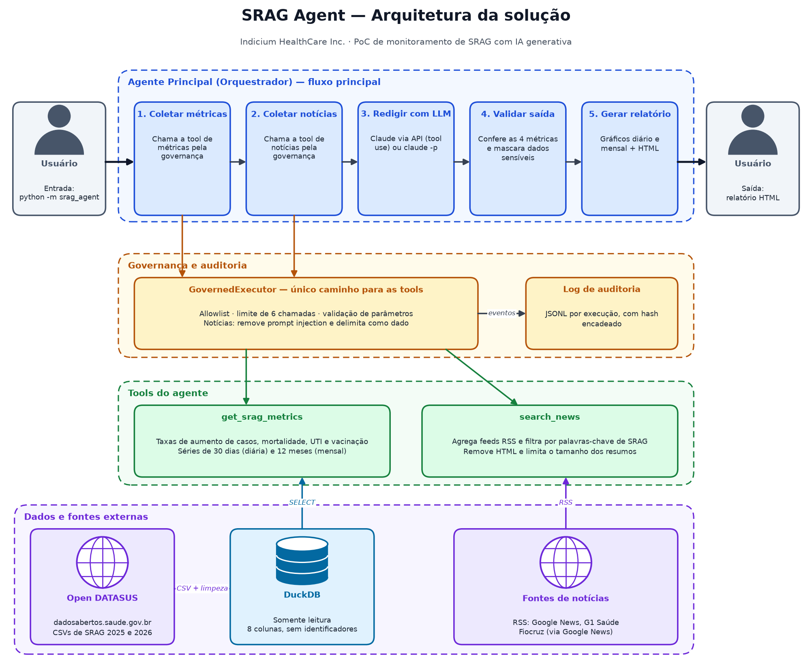

# Agente de Monitoramento de SRAG

PoC da Indicium HealthCare Inc.: um agente de IA generativa que consulta dados reais do Open DATASUS e notícias em tempo real para gerar um relatório automatizado sobre a Síndrome Respiratória Aguda Grave (SRAG), com métricas, gráficos e comentários que contextualizam o cenário.

- Exemplo de relatório gerado: [docs/exemplo-relatorio.html](docs/exemplo-relatorio.html) (versão em texto: [docs/exemplo-relatorio.md](docs/exemplo-relatorio.md))
- Exemplo de log de auditoria: [docs/exemplo-auditoria.jsonl](docs/exemplo-auditoria.jsonl)
- Diagrama da arquitetura (PDF): [docs/arquitetura.pdf](docs/arquitetura.pdf)

## O que o relatório contém

| Item | Definição |
|---|---|
| Taxa de aumento de casos | Variação % entre os últimos 30 dias e os 30 dias anteriores, por data de notificação |
| Taxa de mortalidade | Óbitos por SRAG ÷ casos com desfecho conhecido (cura, óbito ou óbito por outras causas) |
| Taxa de ocupação de UTI | Casos internados em UTI ÷ casos internados |
| Taxa de vacinação | Casos de SRAG com vacina COVID-19 registrada ÷ casos com essa informação preenchida (**proxy**) |
| Gráfico diário | Casos por dia nos últimos 30 dias |
| Gráfico mensal | Casos por mês nos últimos 12 meses (o mês corrente aparece em tom claro por ser parcial) |
| Comentários | Texto do agente relacionando as métricas às notícias recentes |

A janela termina na **última data de notificação do dataset**, e não em "hoje", porque os dados do DATASUS têm atraso.

## Arquitetura



O diagrama em PDF (exigido pelo desafio) está em [docs/arquitetura.pdf](docs/arquitetura.pdf). Para regenerá-lo: `python -m srag_agent.report.diagram`.

**Componentes**

- **Agente Principal (Orquestrador):** conduz a geração do relatório. Valida a saída e pede uma única correção se faltar alguma métrica.
- **Governança (`GovernedExecutor`):** é o único caminho pelo qual o agente chama tools. Aplica allowlist, limites e sanitização, e audita tudo.
- **Tools:**
  - `get_srag_metrics` calcula as métricas e as séries sobre o banco DuckDB, em modo somente leitura.
  - `search_news` agrega feeds RSS (Google News, G1 Saúde e Fiocruz), filtra por relevância e limpa o conteúdo.
- **LLM:** Claude, por um de dois backends (abaixo).
- **Relatório:** gráficos em matplotlib e HTML autocontido.

### Dois backends de LLM

Escolhidos pela variável `SRAG_BACKEND` no `.env`. Tools, governança, validação e relatório são os mesmos nos dois; muda apenas quem escreve o texto.

| Backend | Como funciona | Quando usar |
|---|---|---|
| `api` (padrão) | Loop de **tool use** com a API da Anthropic: o modelo decide quais tools chamar, em até 8 turnos | Mostra a arquitetura agêntica completa. Exige `ANTHROPIC_API_KEY` com créditos |
| `cli` | O Python chama as tools e faz **uma** chamada a `claude -p` (login da conta Claude Code), com todas as ferramentas do Claude Code desligadas | Quando não há créditos de API, ou para rodar com o login da conta |

No backend `cli`, o modelo só escreve texto: `--tools ""` impede que uma notícia maliciosa acione Bash, leitura de arquivos ou rede. A CLI também roda sem persistir sessão, sem carregar hooks e plugins do ambiente, com teto de gasto e em um diretório temporário. As variáveis `ANTHROPIC_API_KEY` e `ANTHROPIC_AUTH_TOKEN` são removidas do subprocesso para a CLI usar o login da conta.

## Dados

Fonte: [SRAG 2019 a 2026 — Open DATASUS](https://dadosabertos.saude.gov.br/dataset/srag-2019-a-2026) (SIVEP-Gripe). Usamos os CSVs de **2025** e **2026**, que juntos cobrem os últimos 12 meses.

Os dados são reais e têm problemas de preenchimento. Tratamentos aplicados em [`data/cleaning.py`](src/srag_agent/data/cleaning.py):

- Só **8 das 194 colunas** são lidas: `DT_NOTIFIC`, `DT_SIN_PRI`, `SG_UF_NOT`, `HOSPITAL`, `UTI`, `EVOLUCAO`, `DT_EVOLUCA`, `VACINA_COV`.
- Datas aceitas em ISO (`2025-07-23T00:00:00.000Z`) e em `dd/mm/aaaa`. Linhas sem data de notificação ou com data no futuro são descartadas.
- Códigos fora do domínio, ausentes ou `9` viram "ignorado" e ficam fora dos denominadores.
- Data de desfecho anterior à notificação é descartada (o caso é mantido).
- Os dados limpos são gravados em DuckDB, para não reprocessar os CSVs a cada execução.

## Governança e transparência

Cada execução gera um arquivo em `audit_logs/run-<id>.jsonl` com:

- início e fim da execução e o backend usado;
- cada chamada de tool (nome e parâmetros), o resumo do resultado e os bloqueios;
- cada resposta do modelo (motivo de parada e tokens) ou da CLI (uso e custo);
- o resultado da validação do relatório e o caminho do arquivo gerado.

Cada registro guarda o **hash do anterior**. Alterar ou apagar uma linha quebra a cadeia, e `AuditLog.verify(caminho)` detecta isso. Veja um exemplo real em [docs/exemplo-auditoria.jsonl](docs/exemplo-auditoria.jsonl). Os logs ficam fora do git, e só mantemos esse exemplo.

## Guardrails

| Risco | Proteção |
|---|---|
| Tool indevida ou uso excessivo | Allowlist (`get_srag_metrics`, `search_news`), limite de 6 chamadas, validação dos parâmetros e limite de 8 turnos |
| **Prompt injection** em notícias | Trechos com cara de instrução (PT e EN) são removidos; o conteúdo externo é delimitado por `<conteudo_externo>` e o prompt manda tratá-lo como dado |
| Ação do modelo na máquina (backend `cli`) | Todas as ferramentas do Claude Code desligadas |
| Números inventados | O prompt proíbe recalcular valores, e `check_report` confere se as 4 métricas calculadas aparecem no texto; se faltarem, o agente corrige uma vez, e depois o relatório sai com um aviso de qualidade |
| Hipóteses sem base | O prompt proíbe tratar hipóteses causais como fato e citar fontes que não estejam nos dados ou nas notícias |
| Dados sensíveis na saída | CPF, e-mail, telefone e chaves de API são mascarados no relatório |
| Conteúdo malicioso no HTML | Escape de HTML no texto do modelo e neutralização de links que não sejam `http(s)` |
| Recusa do modelo | Gera erro auditado, e no backend `api` há fallback do lado do servidor |

## Tratamento de dados sensíveis

- Colunas de identificação pessoal (nome, CPF, endereço, data de nascimento etc.) **nunca são lidas**: só as 8 colunas listadas acima são carregadas.
- O modelo recebe apenas métricas agregadas e notícias públicas, nunca registros individuais.
- Os CSVs, o banco DuckDB, os logs de auditoria e os relatórios gerados ficam fora do git (`.gitignore`), assim como o `.env`.
- A chave de API é lida do ambiente e nunca é registrada nos logs.

## Como rodar

Requisitos: Python 3.11 ou superior. Para o backend `cli`, a CLI `claude` instalada e autenticada.

```bash
# 1. Ambiente
python -m venv .venv
.venv\Scripts\activate          # Linux/macOS: source .venv/bin/activate
pip install -e ".[dev]"

# 2. Configuração: crie o arquivo .env (veja a tabela abaixo)

# 3. Dados: baixe os CSVs e salve em data/raw/
#    https://s3.sa-east-1.amazonaws.com/ckan.saude.gov.br/SRAG/2025/INFLUD25-09-11-2026.csv
#    https://s3.sa-east-1.amazonaws.com/ckan.saude.gov.br/SRAG/2026/INFLUD26-09-11-2026.csv
python -m srag_agent.data       # limpa e grava data/processed/srag.duckdb

# 4. Gerar o relatório
python -m srag_agent            # saída em reports/relatorio-AAAA-MM-DD.html
```

Os nomes dos arquivos mudam a cada atualização do DATASUS. Qualquer `*.csv` em `data/raw/` é lido.

Variáveis do `.env`:

| Variável | Uso |
|---|---|
| `SRAG_BACKEND` | `api` (padrão) ou `cli` |
| `ANTHROPIC_API_KEY` | Obrigatória no backend `api`. Nunca versione o `.env` |
| `SRAG_MODEL` | Modelo do backend `api` (padrão `claude-opus-5-5`) |
| `SRAG_CLI_MODEL` | Modelo do backend `cli` (padrão: o da própria CLI) |

## Testes

```bash
pytest          # 28 testes, sem rede e sem chamar o LLM
ruff check src tests
```

Os testes cobrem limpeza, métricas, tools, guardrails, auditoria, os dois backends (com LLM e subprocesso simulados), relatório e diagrama.

## Estrutura

```
src/srag_agent/
  data/         # limpeza do CSV, métricas e banco DuckDB
  tools/        # get_srag_metrics e search_news
  agent/        # orquestradores (api e cli), prompts e factory
  governance/   # auditoria, guardrails e executor governado
  report/       # gráficos, relatório HTML e diagrama
tests/
docs/           # diagrama (PDF/PNG) e exemplos de relatório e de auditoria
```

## Limitações

- Os dados do DATASUS têm atraso: os últimos dias da série diária e o mês corrente estão subnotificados.
- Casos recentes têm desfecho em aberto, o que **subestima a mortalidade** no período mais recente.
- A taxa de vacinação é um **proxy**: proporção de casos de SRAG vacinados contra COVID-19, e não cobertura vacinal da população.
- A proteção contra prompt injection é por padrões conhecidos: reduz o risco, mas não o elimina.
- O texto gerado pelo modelo pode conter frases interpretativas leves, mesmo com as regras do prompt. Revise antes de usar em decisões.
- O feed da Fiocruz usa o Google News restrito ao portal, porque a Fiocruz não publica RSS oficial. Ele traz poucos itens.
- No backend `cli`, o modelo não decide quais tools chamar: o Python as chama.
